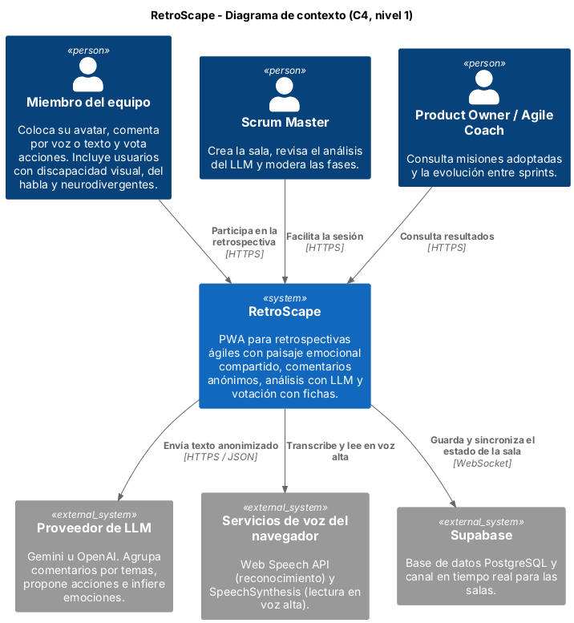
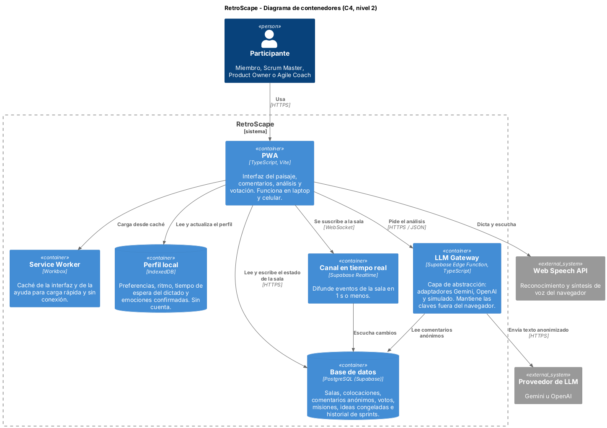

# Arquitectura

Arquitectura planificada de la aplicación, que se implementará desde el Sprint 1, documentada con el modelo C4. Los diagramas están en `docs/diagramas/` y se regeneran con PlantUML:

```bash
java -jar plantuml.jar -tpng -charset UTF-8 docs/diagramas/*.puml
```

## Nivel 1: contexto



RetroScape lo usan tres tipos de personas: los miembros del equipo (incluidos usuarios con discapacidad visual, del habla y neurodivergentes), el Scrum Master que facilita la sesión, y el Product Owner o Agile Coach que consulta los resultados. Depende de tres servicios externos: un proveedor de LLM, los servicios de voz del navegador y Supabase para la base de datos y el tiempo real.

## Nivel 2: contenedores



| Contenedor | Tecnología | Responsabilidad |
|---|---|---|
| PWA | TypeScript, Vite | Interfaz del paisaje, comentarios, análisis y votación |
| Service Worker | Workbox | Caché de la interfaz y de la ayuda para carga rápida y sin conexión |
| Perfil local | IndexedDB | Preferencias, ritmo, tiempo de espera del dictado y emociones confirmadas, sin cuenta |
| LLM Gateway | Supabase Edge Function | Capa de abstracción del LLM; guarda las claves y recibe solo texto anonimizado |
| Base de datos | PostgreSQL (Supabase) | Salas, colocaciones, comentarios anónimos, votos, misiones e historial |
| Canal en tiempo real | Supabase Realtime | Difunde los eventos de la sala en 1 s o menos |

## Decisiones

1. **El navegador nunca llama al LLM.** Lo hace el LLM Gateway, que guarda las claves (RNF-08), recibe solo texto anonimizado (RNF-07) y elige el proveedor mediante adaptadores (RNF-09).
2. **El proveedor simulado es solo para pruebas.** Si el LLM real falla, la app no lo reemplaza con el simulado: avisa y ofrece reintentar o agrupar manualmente (RF-29).
3. **Los comentarios no guardan autor.** La tabla de comentarios no tiene columna de usuario, y el audio del dictado nunca sale del navegador (RF-08).
4. **El perfil vive en el dispositivo.** Se entra sin cuenta, así que la personalización continua se guarda en IndexedDB.
